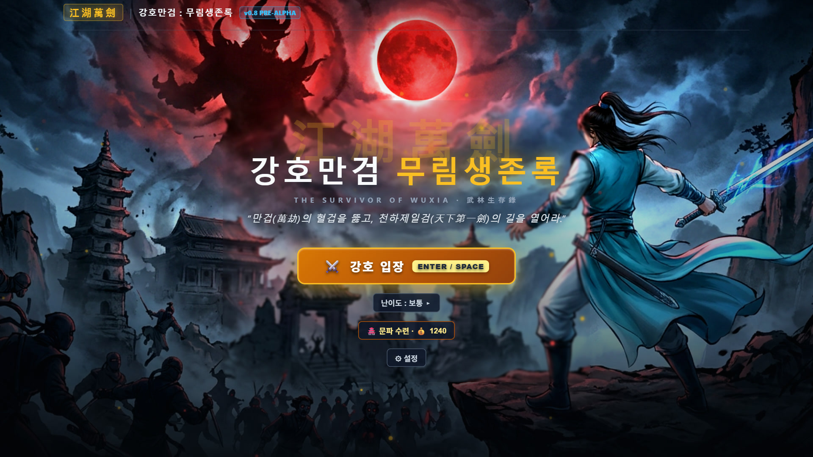
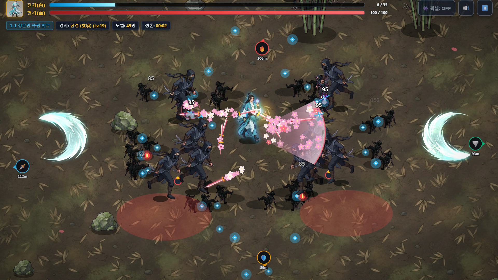
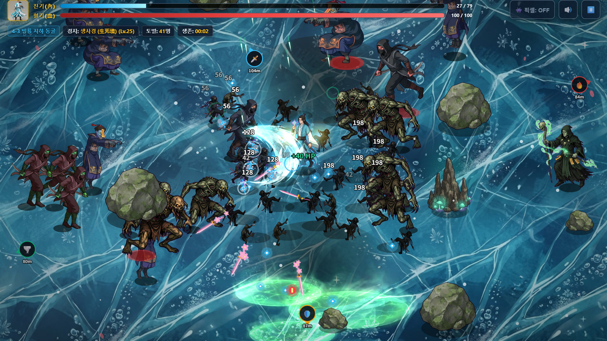
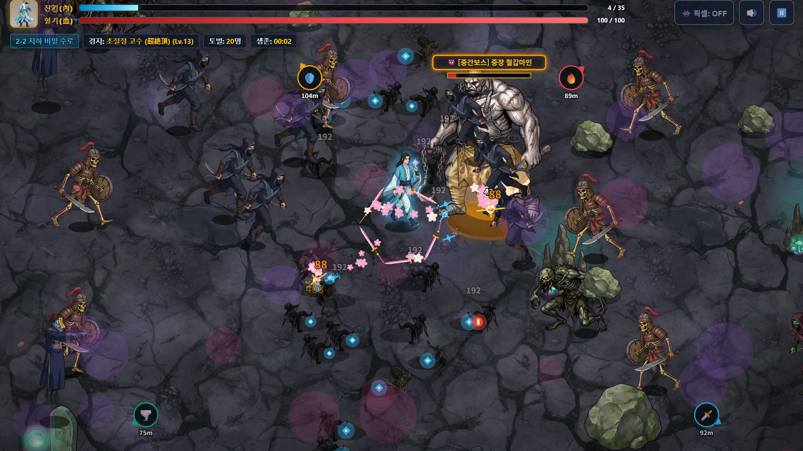
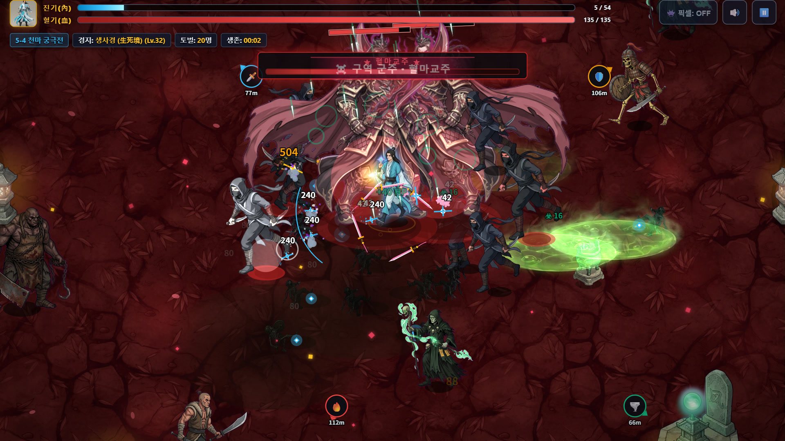

# 강호만검 : 무림생존록 (江湖萬劍)

**몰려드는 사파 무리를 베어 넘기는 무협 생존 액션 웹게임**
설치 없이 브라우저에서 바로 할 수 있습니다 (PC · 폰 가로 화면).

### ▶ [바로 하기 — t-since.github.io/neon-survivor](https://t-since.github.io/neon-survivor/)

| | |
|---|---|
|  |  |
|  |  |

## 어떤 게임인가요
혈마교가 깨어나 강호가 피로 물들었습니다. 청운문의 검객 **서진**이 되어 끝없이 몰려드는 적을 홀로 베어 넘기고, 다섯 구역의 군주를 쓰러뜨리세요.

- **움직이기만 하면 무공이 나갑니다.** 원하면 무공을 직접 쓰는 수동 모드도 있습니다 (오른쪽 위 단추 / T 키)
- **무공을 익히고 초월 각성:** 매화검법, 만천화우, 벽공장, 벽력탄, 금강불괴 … 끝까지 연마하면 초월 무공으로
- **다섯 구역:** 죽림 · 하오문 뒷골목 · 독 밀림 · 북해빙궁 · 혈마전. 구역마다 다른 몹·중간보스·군주
- **판이 끝나도 강해짐:** 은자를 모아 문파 수련으로 영구 강화, 오늘의 과제와 업적
- 한국어 / English

## 조작
| | PC | 폰 |
|---|---|---|
| 이동 | 마우스 또는 W·A·S·D | 화면을 누르고 끌기 |
| 경공(순간 이동) | 스페이스 · 마우스 오른쪽 | 오른쪽 아래 단추 |
| 무공 (수동 모드) | Q · E · R · F | 오른쪽 아래 무공 단추 |
| 자동 ↔ 수동 | T | 오른쪽 위 단추 |
| 일시정지 | Esc | 오른쪽 위 ⏸ |

## 의견 보내기
버그나 하고 싶은 말은 [Issues](../../issues) 에 남겨 주세요. 어떤 기기·브라우저였는지 함께 적어 주시면 고치기 쉽습니다.

## 만든 방법
- 1인 개발, HTML5 Canvas (설치·서버 없음, 저장은 브라우저 안에)
- 그림·음악 일부는 AI 도구(Gemini, ChatGPT)로 만들고 다듬었습니다

---

**Ten Thousand Swords: Murim Survival** — a wuxia survivors-like action game that runs in your browser.
[Play now](https://t-since.github.io/neon-survivor/) · switch the language to English in ⚙ Settings.
